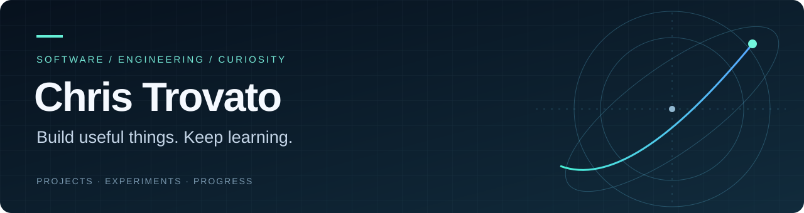

I build software that turns curiosity into something you can use: interactive engineering worlds, tools for exploring public data, and practical automations.

My interests connect **robotics, aerospace, software, and practical AI**. This profile is a record of projects, experiments, and the work of getting better.

**[Explore Beyond Earth ↗](https://ditchthescroll.com/beyond-earth/)** · **[Work log](WORKLOG.md)** · **[How I document progress](WORKFLOW.md)**

## Selected work

| Project | What it does | Explore |
| :--- | :--- | :--- |
| **Beyond Earth** | Connects everyday math to space engineering through lessons, simulations, games, and build studies. | [Live experience](https://ditchthescroll.com/beyond-earth/) · [Code](https://github.com/ChrisTrovato/beyond-earth) |
| **The Factory That Builds the Future** | An interactive learning world exploring robotics, manufacturing, and the systems behind ambitious engineering. | [Live experience](https://factory-that-builds-the-future.vercel.app/) · [Code](https://github.com/ChrisTrovato/factory-that-builds-the-future) |
| **CheckYourWater** | A web application for exploring public drinking-water information. | [Website](https://checkyourwater.org) · [Code](https://github.com/ChrisTrovato/checkyourwater) |
| **AI News Briefing** | A Python workflow for collecting news and producing AI-assisted summaries and briefings. | [Code](https://github.com/ChrisTrovato/ai-news-briefing) |

## How I work

- Start with a useful question, then build something small enough to test.
- Keep the source, assumptions, checks, and limitations close to the project.
- Record meaningful changes and what I learned, rather than chasing a contribution streak.
- Use AI tools openly, with project-level attribution and verification of the results.

## What I’m exploring

**Interactive systems** — simulations, interfaces, and learning tools that make difficult ideas tangible.

**Engineering foundations** — the math and physical intuition behind mechanisms, controls, robotics, and space systems.

**Useful automation** — turning repeated work into dependable, understandable workflows.

---

Open to opportunities to contribute, learn, and build useful things. The repositories above show the work behind that interest.
